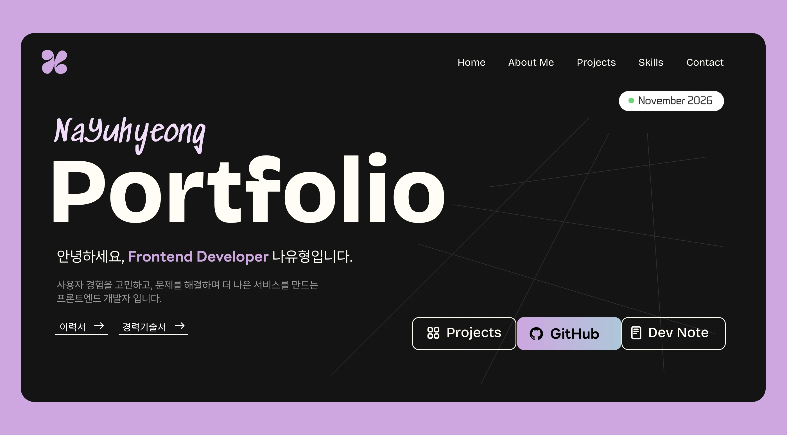

# NAYUHYEONG Portfolio 2026 💜


  

2026년 기준 프론트엔드 개발 프로젝트와 실무 경험을 중심으로 구성한 개인 포트폴리오입니다.
<p align="center">
  
</p>

[Portfolio 바로가기 -> ](https://yumerry1203.github.io/portfolio26/)

## 기술 스택

| 구분 | 기술 |
| --- | --- |
| Core | React 19, TypeScript 6 |
| Build | Vite 8 |
| Styling | Tailwind CSS 4, CSS |
| Animation | GSAP, ScrollTrigger |
| Quality | ESLint |
| Deployment | GitHub Actions, GitHub Pages |

## 화면 구성

### 포트폴리오 메인 페이지

- **Intro**: 최초 방문 세션에서 한 번만 표시되는 3D 로고 인트로
- **Home**: 포트폴리오 Hero, 현재 날짜, 이력서&경력기술서 이동 링크와 개인 채널 바로가기
- **About Me**: 프로필 사진, 소개, 경력 타임라인, 교육 및 자격증
- **Skills**: Frontend, State & Form, UI & Styling, Tools & Environment 기술 스택
- **Projects**: 주요 실무 프로젝트 카드와 프로젝트별 상세 모달
- **Project Archive**: 이전 실무 프로젝트, 사용 기술, 작업 범위 및 사이트 이동 링크
- **Side Projects**: 개인 프로젝트 카드와 사이트 링크, GitHub, 작업 과정 버튼
- **HOW I WORK**: 사용자 경험, 유지보수, 협업, 문제 해결과 협업 방식을 보여주는 스크롤 인터랙션
- **Contact**: 연락처, 메일, 메뉴 Footer

### 문서 페이지

- **Resume**: A4 2페이지로 구성된 이력서와 PDF 저장 기능
- **Career Description**: A4 4페이지로 구성된 경력기술서와 PDF 저장 기능

### 시스템 페이지

- **404 Not Found**: 존재하지 않는 주소로 접근했을 때 표시되는 안내 페이지


## 주요 기능

- 실무 프로젝트와 사이드 프로젝트의 개요, 역할, 주요 작업 내용 정리
- 섹션 단위로 구성된 원페이지 포트폴리오
- 모바일, 태블릿, 데스크톱에 대응하는 **반응형 레이아웃**
- GSAP과 ScrollTrigger를 활용한 스크롤 기반 인터랙션
- 프로젝트별 상세 정보와 문제 해결 사례 확인
- 포트폴리오, GitHub, 개발 노트 등 외부 링크 연결


## 반응형 기준

Tailwind CSS의 모바일 우선 방식으로 구현

| 구간 | 너비 | 주요 대응 |
| --- | ---: | --- |
| Mobile | `0px ~ 639px` | 모바일 Hero, 햄버거 메뉴, 단일 컬럼 카드 |
| `sm` | `640px 이상` | 여백, 글자, 컴포넌트 크기 확장 |
| `md` | `768px 이상` | 태블릿 프로젝트 2열 구성 |
| `lg` | `1024px 이상` | Hero 및 섹션별 데스크톱 전환 시작 |
| `xl` | `1280px 이상` | 주요 프로젝트 좌우 배치, Skills 양쪽 구성 |
| `2xl` | `1536px 이상` | 넓은 데스크톱 레이아웃 유지 |


## 프로젝트 구조

```text
src/
├── App.tsx                         # BrowserRouter 설정 및 최상위 라우터 연결
├── main.tsx                        # React 애플리케이션 진입점
├── index.css                       # Tailwind 및 전역 스타일 진입점
│
├── app/
│   └── AppRouter.tsx               # 홈, 이력서, 경력기술서, 404 라우트 관리
│
├── assets/
│   ├── career/                     # 경력기술서 구분선 SVG
│   ├── fonts/                      # LINE Seed 등 로컬 웹폰트
│   └── images/                     # 로고, 아이콘, 프로젝트 3D 이미지
│
├── components/
│   ├── common/                     # 버튼, 뱃지, 이미지 로딩 등 공통 UI
│   │   ├── Badge.tsx
│   │   ├── Button.tsx
│   │   ├── ContributionSlider.tsx
│   │   ├── DotLabel.tsx
│   │   ├── ExpandingToast.tsx
│   │   ├── LoadingImage.tsx
│   │   └── ProjectStatusBadge.tsx
│   └── layout/                     # 여러 섹션에서 사용하는 레이아웃 요소
│       ├── Header.tsx
│       └── SectionTitle.tsx
│
├── data/
│   ├── AboutMe/
│   │   └── aboutme.ts              # 경력, 교육, 자격증 데이터
│   ├── Projects/
│   │   ├── projects.tsx            # 주요 프로젝트 데이터
│   │   └── projectArchiveData.ts   # 실무 프로젝트 아카이브 데이터
│   ├── SideProjects/
│   │   └── sideprojects.ts         # 개인 프로젝트 데이터
│   └── navigation.ts               # 헤더&푸터 공통 메뉴 데이터
│
├── pages/
│   ├── HomePage.tsx                # 원페이지 섹션 구성 및 인트로 상태 관리
│   ├── NotFoundPage.tsx            # 404 페이지
│   │
│   ├── Resume/
│   │   ├── ResumePage.tsx          # A4 이력서 페이지 및 PDF 출력
│   │   ├── ResumePage.css          # 이력서 화면 인쇄 전용 스타일
│   │   ├── resumeData.ts           # 이력서 콘텐츠 데이터
│   │   └── components/             # 이력서 전용 공통 컴포넌트
│   │       ├── ExperienceItem.tsx
│   │       ├── ResumeSectionTitle.tsx
│   │       ├── ResumeSheet.tsx
│   │       └── SkillTag.tsx
│   │
│   └── Career/
│       ├── CareerPage.tsx           # A4 경력기술서 페이지 및 PDF 출력
│       ├── CareerPage.css           # 경력기술서 화면 인쇄 전용 스타일
│       ├── careerData.ts            # 프로젝트, 문제 해결, 협업 데이터
│       └── components/              # 경력기술서 전용 공통 컴포넌트
│           ├── CareerBulletList.tsx
│           ├── CareerProblemTable.tsx
│           ├── CareerProjectHeader.tsx
│           ├── CareerSectionTitle.tsx
│           ├── CareerSheet.tsx
│           └── CareerTechTags.tsx
│
├── sections/
│   ├── Intro/                      # 최초 방문 시 표시되는 인트로
│   ├── Home/                       # Hero, 헤더
│   ├── AboutMe/                    # 소개, 경력, 교육, 자격증
│   ├── Skills/                     # 기술 스택과 HOW I WORK 인터랙션
│   ├── Projects/                   # 주요 프로젝트 카드와 상세 모달
│   ├── ProjectArchive/             # 실무 프로젝트 이력
│   ├── SideProjects/               # 개인 프로젝트 카드와 상세 모달
│   │   └── processImagePreloader.ts # 작업 과정 이미지 사전 로딩
│   └── Contact/                    # 연락처, Thank You, Footer
│
├── styles/
│   ├── reset.css                   # 기본 스타일 초기화 및 컨테이너
│   └── tokens.css                  # 컬러/폰트/간격/그림자 디자인 토큰
│
└── type/
    ├── project.ts                  # 주요 프로젝트 데이터 타입
    └── sideproject.ts              # 개인 프로젝트 데이터 타입
```


## 데이터 관리

프로젝트 콘텐츠와 화면 UI를 분리해 데이터 파일만 수정해도 카드와 상세 모달에 동일하게 반영되도록 구성했습니다.

- 주요 프로젝트: `src/data/Projects/projects.tsx`
- 프로젝트 아카이브: `src/data/Projects/projectArchiveData.ts`
- 개인 프로젝트: `src/data/SideProjects/sideprojects.ts`
- 경력/교육/자격증: `src/data/AboutMe/aboutme.ts`
- 공통 메뉴: `src/data/navigation.ts`
- 이력서: `src/pages/Resume/resumeData.ts`
- 경력기술서: `src/pages/Career/careerData.ts`

주요 프로젝트의 `role`, `category`, `skills` 등의 정보는 메인 프로젝트 카드와 상세 모달에서 동일한 데이터를 공유합니다.

## Fonts

### 로컬 웹폰트

- LINE Seed KR (Thin/Regular/Bold) - 메인
- SEBANG Gothic (Regular/Bold) - 포인트

### Google Fonts

- Sedgwick Ave - hero 전용
- Bricolage Grotesque - 포인트

## 🎨 Color System

### Brand Colors


### Neutral Colors


### Gradient


```css
--primary: #CEA6E0;
--secondary: #F1DBFA;
--sky: #AEC7D8;
--accent: #EC563B;
--green: #74D07D;

--pure-black: #000000;
--black: #141414;
--gray-dark: #2F2F2F;
--gray: #999999;
--white: #FFFFFF;

--gradient: linear-gradient(
  135deg,
  #AEC7D8 0%,
  #CEA6E0 100%
);
